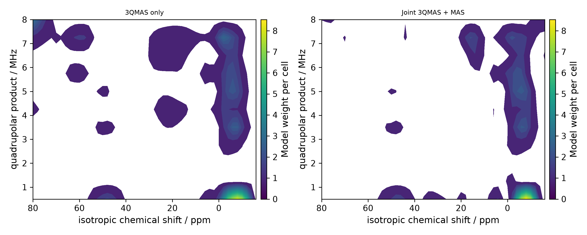
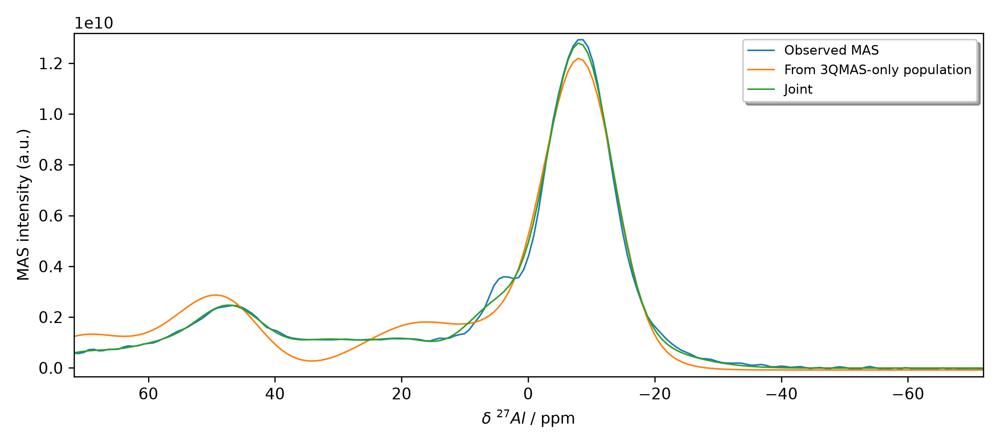
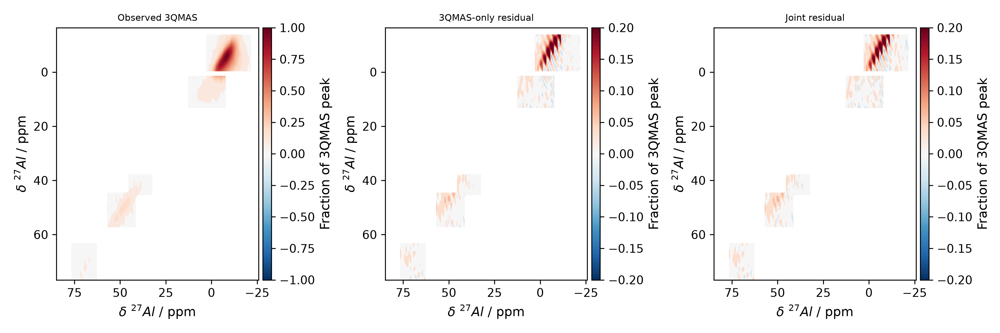

Invert PBG1 MQMAS with a shared MAS population
==============================================

Use ``scp.nmr.mqmas_inversion`` to estimate a nonnegative distribution on an
isotropic chemical shift and quadrupolar-product grid. This example compares
an inversion of the signed 3QMAS map with an adjustment of the same
population map to both 3QMAS and a one-dimensional MAS spectrum.

For a half-integer quadrupolar nucleus, define

.. math::

   P_Q = |C_Q|\sqrt{1+\eta^2/3}.

Each kernel column represents one grid cell in
:math:`(\delta_\mathrm{iso}, P_Q)`. The template is averaged over a uniform
:math:`\eta` distribution between zero and one at fixed :math:`P_Q`.
The averaging is applied to the simulated response before fitting the
population map. For each averaging node, the simulator uses
:math:`|C_Q|=P_Q/\sqrt{1+\eta^2/3}`. The map therefore estimates model
weights in shift and :math:`P_Q`. An individual asymmetry remains available
as a parameter for a subsequent line-shape fit.

Get the PBG1 spectra
--------------------

Download and extract ``raw data.rar`` from the PBG dataset by Davide
Bernasconi, with data collected by Pierre Florian and Franck Fayon, released
under CC BY 4.0. The archive contains ``raw data/PBG1_2,5mm``. Its SHA-256 is
``9dea155c54c70a3c0ea0ee13ccedda0c36ba286d7962b60795c8e9dbdbcce405``.
See the `Zenodo dataset <https://doi.org/10.5281/zenodo.17130697>`_.

The example reads the existing phased spectra. Experiment 13 supplies the
sheared :sup:`27`\ Al 3QMAS RR plane and experiment 1 supplies the MAS spectrum.
Pass ``proc_axis=True`` to retain the archived processing references,
including the isotropic F1 scale. Both acquisitions use 30 kHz MAS.

Download :download:`the complete Python example
<../../examples/analysis/pbg1_mqmas_inversion.py>` and run it with the
extracted sample directory. It requires a plugin version containing the
MQMAS inversion API introduced by NMR PR #149.

.. code-block:: console

   OPENBLAS_NUM_THREADS=1 python pbg1_mqmas_inversion.py \
       "/path/to/raw data/PBG1_2,5mm" --output pbg1-inversion

The script creates figures, a JSON table of fit metrics, and an NPZ file
containing the grids, masks, observations, populations and predictions.
Kernel construction is CPU intensive. Allow tens of minutes on a shared
CPU for the default settings. Run the example separately to refresh the figures and numerical results shown below.

Select the fitted data
----------------------

.. code-block:: python

   from pathlib import Path
   import numpy as np
   import spectrochempy as scp

Subtract a constant baseline from each 3QMAS F2 row, estimated in the
signal-free interval from −65 to −40 ppm. Keep signed intensities, including
the negative lobes. The five rectangular fit windows follow the resolved
3QMAS regions. Masking the rest of the map gives the two fits identical
spectral support. Retain every second F2 point to reduce the kernel size.
The MAS fit uses the central window within 14 kHz of the spectral reference.

.. literalinclude:: ../../examples/analysis/pbg1_mqmas_inversion.py
   :language: python
   :start-at: REGIONS =
   :end-before: def build_kernels

Construct the two kernels
-------------------------

The 3QMAS template simulates the excitation, conversion and readout pulses
with a z filter. The archived pulse durations are 3.7, 1.25 and 8.3 μs.
The RF amplitudes are model assumptions of 100, 100 and 10 kHz. A global
180° receiver phase sets the absorptive sign of this simulated pathway.
The F1 response uses the 21 acquired States increments, the stored dwell,
15 Hz exponential line broadening and first-point factor 0.5. The indirect
dwell is one rotor period for this acquisition. F2 uses a
Gaussian width of 0.6 ppm standard deviation.

The MAS template simulates the archived 0.5 μs excitation with an assumed
50 kHz RF amplitude and a Gaussian width of 1600 Hz FWHM. It supplies the
order-zero spinning response for the fitted central window. The simulated
frequency window and point count are numerical settings for the template.
The carrier and Larmor reference come from each spectrum's metadata.
PULSAR derives the MAS rotor phase grid from the simulated frequency window
and powder accuracy. A convergence trial can increase the window to
4 MHz and the point count to 65537, retaining the same frequency bin width.
Spot checks on 185 points from −72 to 72 ppm, at zero chemical shift and
:math:`\eta=0.5`, change the MAS template by less than 1.4% in relative L2 norm for :math:`C_Q` values of
0.5, 4 and 8 MHz under that change.

.. literalinclude:: ../../examples/analysis/pbg1_mqmas_inversion.py
   :language: python
   :start-at: def build_kernels
   :end-before: def compare

The default parameter grid has 49 shift points from −16 to 80 ppm and
11 :math:`P_Q` points from 0.5 to 8 MHz. Three Gaussian quadrature nodes
average over :math:`\eta`. The 3QMAS response uses a powder order of 5 and
12 rotor phases. The MAS powder accuracy is 5. The shift spacing is 2 ppm.
The MAS calculation selects the optional tridiagonal RF backend, with dense
fallback when the accelerator is absent. Install the plugin's ``rf`` extra
to enable that backend. Increase grid density, asymmetry quadrature and
powder sampling separately when evaluating convergence. The command-line options
``--shift-points``, ``--pq-points`` and ``--eta-nodes`` control the first two.
A 25-point shift grid, spaced by 4 ppm, gave a 13.07% 3QMAS-only RMS on
these data. The default grid uses the finer shift spacing to resolve the
spectral responses before comparing the population maps.

``asymmetry="czjzek"`` selects the isotropic Czjzek distribution of asymmetry
conditional on :math:`P_Q`. Its normalized density is proportional to
:math:`\eta(1-\eta^2/9)/(1+\eta^2/3)^{5/2}`. Rebuild both kernels with the
same choice to compare that assumption. This choice weights the asymmetry
average within a cell. The fitted :math:`P_Q` marginal remains free.

Fit one shared population map
-----------------------------

Both inversions use regularization 0.1 on the same physical population
coordinates. The joint objective averages peak-normalized squared errors
within each experiment, adds the squared second-difference penalty, and
uses ``mas_weight=1``. Thus each experiment contributes its mean squared
error even though their point counts differ.

The joint fit adjusts a positive MAS gain and an additive MAS baseline.
For comparison, project the 3QMAS-only population through the MAS kernel
and calibrate its gain and baseline while keeping that population fixed.
This shows how well the population inferred from 3QMAS predicts the MAS
line shape before including the MAS residual in the population inversion.

.. literalinclude:: ../../examples/analysis/pbg1_mqmas_inversion.py
   :language: python
   :start-at: def compare
   :end-before: def summarize

Call these functions with a common grid for the two kernels.

.. code-block:: python

   pbg1 = Path("/path/to/raw data/PBG1_2,5mm")
   mqmas, mas = read_spectra(pbg1)
   shifts = scp.Coord.linspace(-16, 80, 49, units="ppm")
   products = scp.Coord.linspace(0.5, 8, 11, units="MHz")
   kernel_3q, kernel_mas = build_kernels(
       mqmas, mas, shifts.data, products.data, eta_nodes=3
   )
   mq_only, joint, prediction = compare(mqmas, mas, kernel_3q, kernel_mas)
   print(mq_only.rms, joint.rms, joint.mas_rms)

.. include:: ../_static/pbg1-inversion/metrics.rst

   The same color scale displays the fitted model weight per grid cell.
   Both inversions use the peak of the fitted 3QMAS spectrum as their
   intensity reference.

   The two MAS predictions have their own fitted gain and baseline. Only
   the joint fit uses MAS intensities to update the population map.

   Observation and residuals are divided by the observed 3QMAS peak.
   The two residual panels share limits of ±20% of the peak. White areas are
   masked.

Interpret the comparison
------------------------

The local weight in the table sums cells from −14 to 0 ppm with
:math:`P_Q<1.5` MHz. The local fraction divides this sum by the total
weight of each map. The local maximum stays at (−8 ppm, 0.5 MHz), on the
lower :math:`P_Q` boundary, for both fits. Inspect its value together with both residuals and the
whole map. A better MAS fit can redistribute weight between regions that
have similar 3QMAS responses. The fitted weights retain the model's
intensity scale. Quantitative populations also depend on excitation,
relaxation, broadening and how both experiments are calibrated.

The 3QMAS generator represents a fixed-transfer, sheared centerband model
with the powder-mean isotropic F1 frequency. Its finite time response
includes the chosen F1 window. It omits conversion changes throughout
indirect evolution and correlations between F1 and F2 spinning sidebands.
The MAS generator applies its pulse sequence and Gaussian broadening
before sampling on the experimental axis. The archived receiver dead time,
digital filter and processing phase ramps would require an
acquisition-specific response callback to replay explicitly.

The low :math:`P_Q` result is sensitive to the grid boundary and to weak
3QMAS kernel columns. Compare alternative lower bounds, widths and
regularizations before assigning that component. For MQMAS alone,
``normalize_columns=True`` regularizes unit-column amplitudes and converts
them back to populations. This changes the regularization prior. The joint
fit regularizes physical populations and uses columns supported by either
experiment. ``minimum_column_norm`` controls the relative response cutoff.

Use :func:`~spectrochempy_nmr.mqmas_inversion.profile` to reoptimize a chosen
local population sum for several candidate MAS widths. A profile quantifies
sensitivity within the supplied model and support. See
:doc:`../reference/mqmas_inversion` for the complete API.
